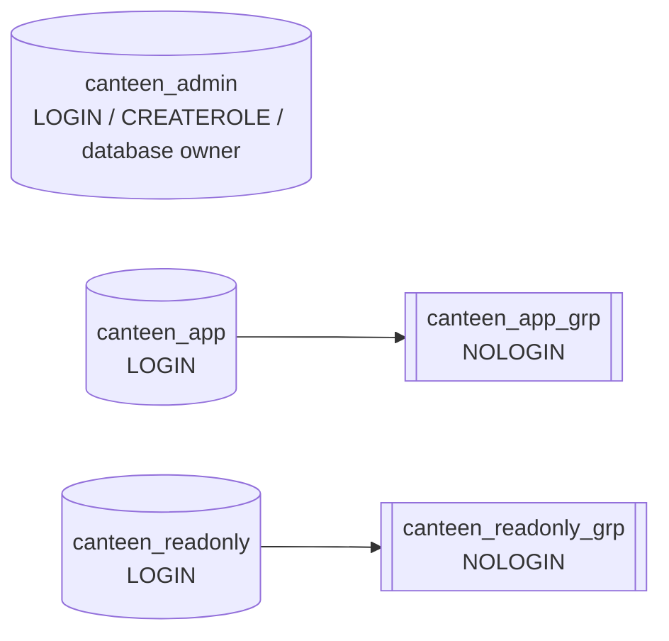

# PostgreSQL access control

## Security architecture

The application database defaults to `canteen_db`; the application schema is
`public`. It contains seven tables: `student`, `vendor`, `menu_item`,
`customer_order`, `order_item`, `queue_entry`, and `notification`. Their `SERIAL`
primary keys use seven PostgreSQL sequences. The migrations create these
objects; access-control scripts do not alter migration history.

Spring Boot connects as `canteen_app`, a non-owner, non-superuser runtime login.
`canteen_admin` owns the database and application objects and is reserved for
setup, migrations, and maintenance. `canteen_readonly` is for reporting.
Student, vendor, and application-admin identities are rows in application
tables, not PostgreSQL logins.

## Roles and memberships



The runtime and read-only accounts have no `SUPERUSER`, `CREATEDB`,
`CREATEROLE`, replication, or `BYPASSRLS` attributes. Only the maintenance
account has `CREATEROLE`; it has no superuser or database-creation attribute.
No application login is a member of the maintenance account.

## Least-privilege grants

| Object | Runtime group | Read-only group | Reason |
|---|---|---|---|
| `student` | SELECT, INSERT | None | Registration and login; no application student updates/deletes |
| `vendor` | SELECT, INSERT, UPDATE | SELECT `vendor_id`, `vendor_name` | Registration, stall enable/disable, reports |
| `menu_item` | SELECT, INSERT, UPDATE, DELETE | SELECT `item_id`, `vendor_id`, `item_name`, `price`, `is_available` | Vendor menu workflows; deletion exists only here |
| `customer_order` | SELECT, INSERT, UPDATE | SELECT `order_id`, `vendor_id`, `order_date`, `status` | Place, display, and transition orders; report aggregation |
| `order_item` | SELECT, INSERT | SELECT `order_id`, `item_id`, `quantity`, `price_at_order` | Create order lines and sales reports |
| `queue_entry` | SELECT, INSERT, UPDATE | None | Queue numbering and status transitions |
| `notification` | SELECT, INSERT, UPDATE | None | Create and mark notifications read |
| Sequences | USAGE, SELECT | None | Runtime-generated `SERIAL` IDs; no sequence modification |

`DELETE` is granted on `menu_item` because `MenuService.delete` deletes an item
only when it has no order history; past items are instead marked unavailable.
Foreign keys protect historical items. There is no `TRUNCATE` grant. The
table-level UPDATE grants on entities changed by the API are necessary because
Hibernate's default entity updates may set all mutable columns when one field
changes. Student and order-item entities are not modified, so those tables have
no UPDATE grant. The application is not granted SQL row-level isolation:
authorization of a vendor's own row is enforced by the API, while direct
database credentials should be restricted to the application process.

Reporting uses `vendor`, `menu_item`, `customer_order`, and `order_item`.
Read-only column grants omit password hashes and personal student data.
`student`, `queue_entry`, and `notification` are intentionally not approved for
the reporting account. No default table grants are given to the read-only
group, so a new table must be approved explicitly. Future tables created by
`canteen_admin` in `public` receive only runtime SELECT/INSERT/UPDATE by default;
future sequences receive runtime USAGE/SELECT. Future application objects must
be reviewed before their access is granted.

Both app groups receive schema USAGE, not CREATE. The scripts revoke
`PUBLIC` privileges on application database objects. Role membership does not
give the runtime ownership of the database or objects.

## Local credentials

Copy `.env.example` to `.env`, then set distinct local passwords for
`DB_ADMIN_PASSWORD`, `DB_PASSWORD` (runtime), and
`DB_READONLY_PASSWORD`. Keep `.env` out of Git. The role-creation script uses
psql's hidden `\password` prompt; enter the same values configured locally.
Passwords are not embedded in SQL or passed as SQL script variables.

Spring Boot reads `DB_USER` (default `canteen_app`) and `DB_PASSWORD`; it must
never run as `canteen_admin`. The setup scripts use `DB_ADMIN_USER` and
`DB_ADMIN_PASSWORD` only to create/migrate the database. Do not use database
login passwords for application-level student/vendor accounts.

## Installation and SQL execution

Run commands from the repository root. The PostgreSQL account used to create
roles and apply ownership/security changes must be a superuser. Use a protected
local terminal and do not place a password literal in a command.

1. Copy `.env.example` to `.env` and set credentials.
2. Load local connection settings in PowerShell without printing their values:

   ```powershell
   Get-Content .env | ForEach-Object {
     if ($_ -match '^\s*#' -or $_ -notmatch '=') { return }
     $name, $value = $_ -split '=', 2
     Set-Item -Path "Env:$($name.Trim())" -Value $value
   }
   ```
3. Create and set role passwords (interactive hidden prompts):

   ```powershell
   psql -h $env:DB_HOST -p $env:DB_PORT -U postgres -d postgres `
     -v ON_ERROR_STOP=1 -f .\db-access-control\01-create-roles.sql
   psql -h $env:DB_HOST -p $env:DB_PORT -U postgres -d postgres `
     -v ON_ERROR_STOP=1 -f .\db-access-control\02-role-memberships.sql
   ```

   The password prompts require an interactive psql terminal and reset the
   matching role passwords whenever this script is rerun. Set matching values
   in `.env`; do not rerun it unless you are prepared to synchronize those values.
4. Create the database, run migrations and seeds, then apply database grants:

   ```powershell
   powershell -ExecutionPolicy Bypass -File .\database\setup.ps1
   ```

   Setup applies scripts `03` through `06` after migrations. The database and
   objects are owned by `canteen_admin`; app credentials are not used for
   migrations.
5. Review every database on the PostgreSQL cluster before applying
   `07-security-restrictions.sql`. This script removes `PUBLIC CONNECT` from
   every connectable database so that the app logins cannot reach unrelated
   databases. It can affect other applications on the same cluster. Restore
   explicit CONNECT grants for legitimate users before using it:

   ```powershell
   psql -h $env:DB_HOST -p $env:DB_PORT -U postgres -d postgres `
     -v ON_ERROR_STOP=1 -v target_db=$env:DB_NAME `
     -f .\db-access-control\07-security-restrictions.sql
   ```
6. Inspect actual ACLs with `08-privilege-verification.sql`, then execute the
   SQL tests in [tests/access-control-test-plan.md](tests/access-control-test-plan.md).

For systems using Bash, use `psql -h "$DB_HOST" -p "$DB_PORT" -U postgres -d
postgres -v ON_ERROR_STOP=1 -f db-access-control/01-create-roles.sql` and the
corresponding paths. The test plan gives Windows PowerShell commands.

## Verification commands

The verification script includes `\du+`, `\dn+`, `\dp`, `\ddp` and checks
`has_database_privilege`, `has_schema_privilege`, `has_table_privilege`,
`has_column_privilege`, and `has_sequence_privilege`. Review ownership with its
relation owner column. Run actual connection and write-denial tests using the
login accounts, as privilege inspection alone does not prove a successful
connection.

Expected tests and exact commands are in
[tests/access-control-test-plan.md](tests/access-control-test-plan.md). A
test is verified only after it has actually run and its output/exit status has
been reviewed.

## Limitations and unresolved operational concerns

- Script 07 changes `CONNECT` defaults cluster-wide. Review existing databases
  and restore explicit grants for their legitimate clients before running it.
- PostgreSQL grants are table/column-level, not vendor-row-level. The API
  enforces vendor ownership; the runtime database credential must not be
  exposed to users or reporting clients.
- The runtime retains DELETE on menu items to support the current API path.
  The service preserves history by disabling items with orders, and foreign
  keys reject deletion of referenced items.
- New reporting data requires an explicit reviewed grant; it is not inherited
  automatically by `canteen_readonly_grp`.
- These scripts must be run against the actual configured PostgreSQL cluster.
  Repository inspection alone does not demonstrate that a role, grant, or
  connection test has executed.

## Other-group Activity 4 templates

The `group-01/`, `group-02/`, and `group-03/` folders are provisional **TEMPLATE — replace with real project data** placeholders, not confirmed group identities or additional canteen databases. Each contains a plan, blockers, and comment-only `.sql.template` files for a future owner-approved project. Do not execute or copy the canteen-specific SQL above into another group's repository or database. Confirm inventory, schema, roles, authorization, and expected results first; keep missing information `BLOCKED`.
